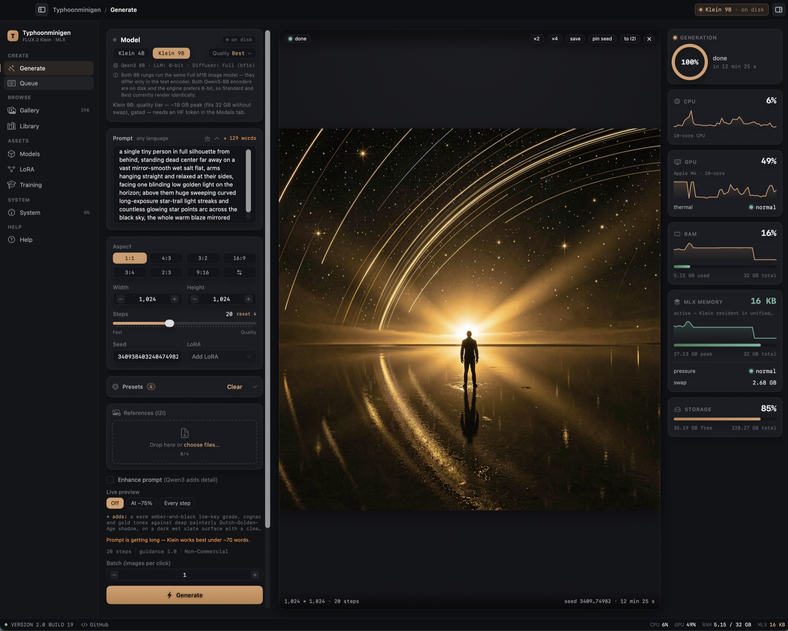
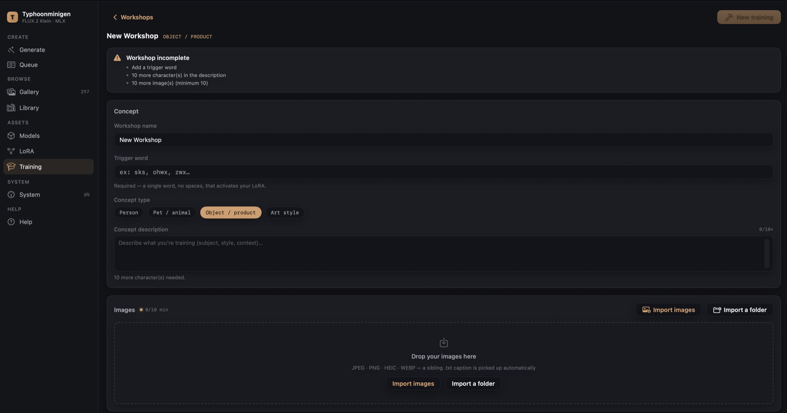
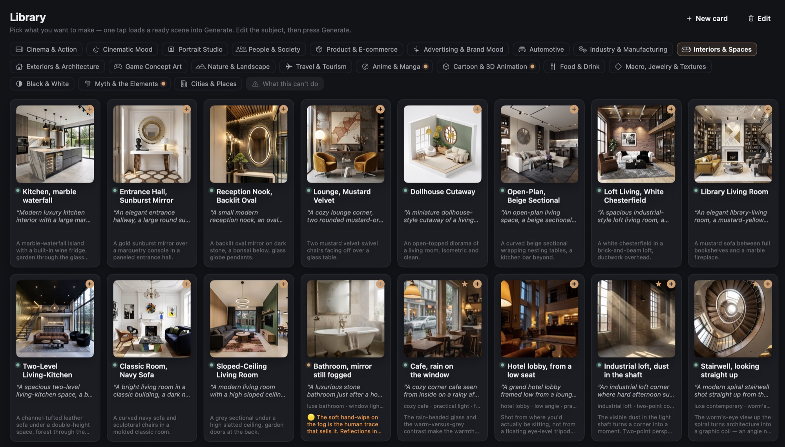
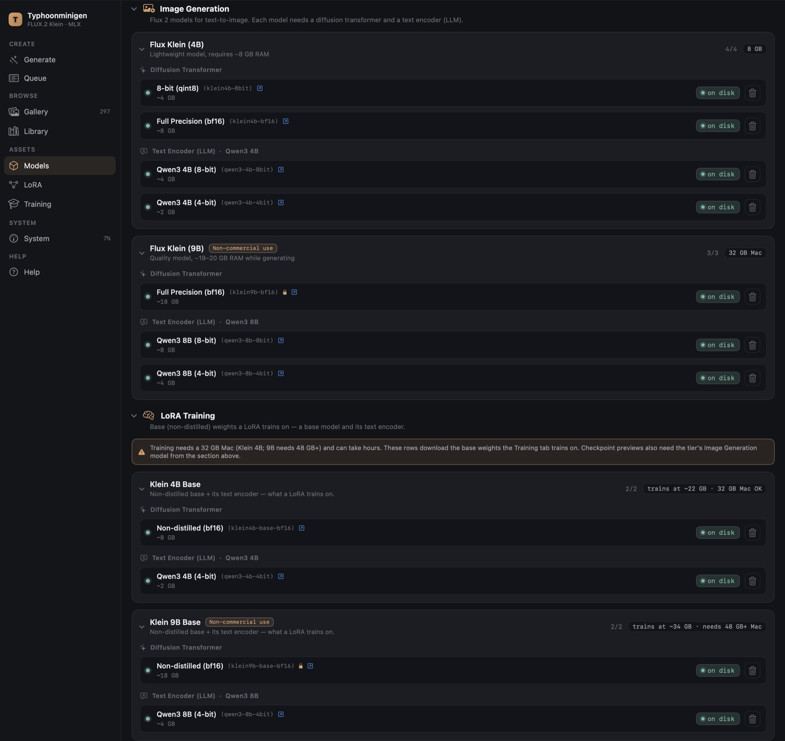
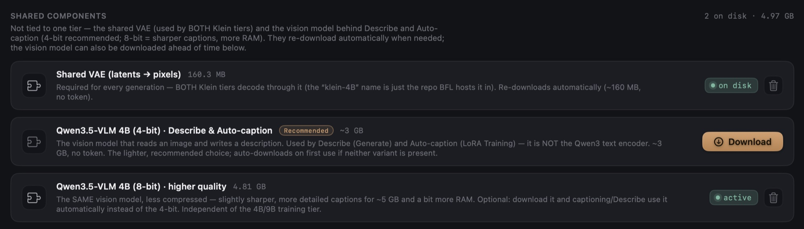
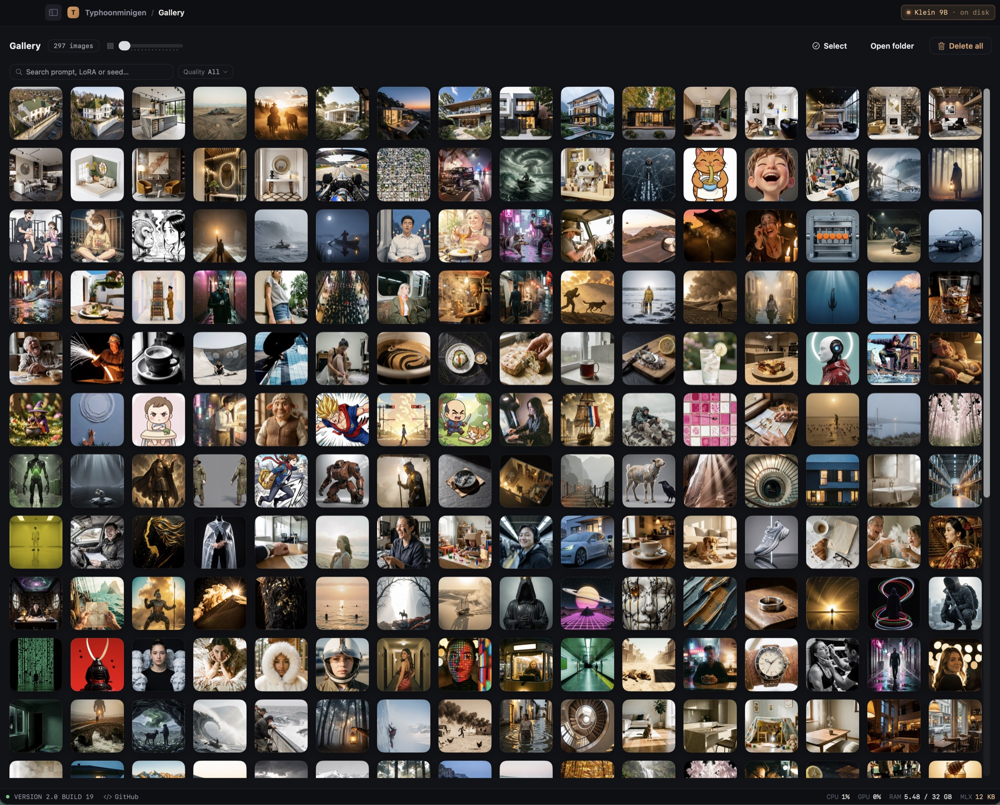
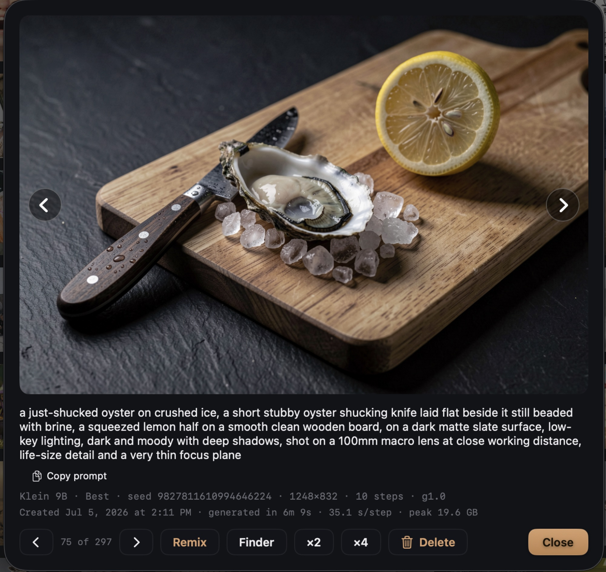
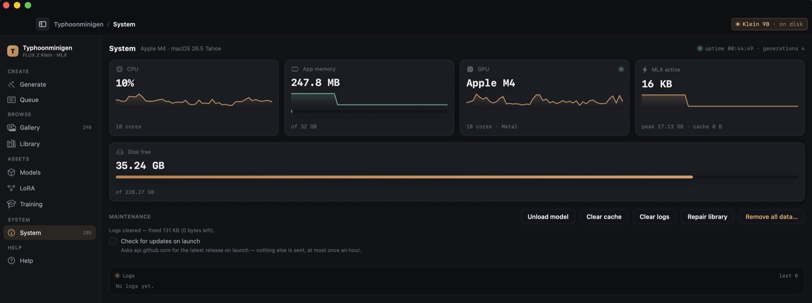

# Typhoonminigen

[](https://github.com/abgitdev/Typhoonminigen/actions/workflows/build.yml)   [](LICENSE)     [](https://github.com/abgitdev/Typhoonminigen/commits/main) 

A native macOS image generator for **FLUX.2 Klein**, running fully on-device on Apple Silicon
through **MLX** — no Python, no ComfyUI, no local server. Type a prompt in **any language**,
press Generate, get an image. Reference images (image-to-image), LoRA adapters — and since 2.0
a full **on-device LoRA Training Studio**, a **247-scene Library**, and a gallery where every
image carries its own reproducible recipe.

> Not affiliated with SCB 10X's "Typhoon" LLMs or any other Typhoon-named project. "FLUX" is a
> trademark of Black Forest Labs; this is an independent client for it.



*The Generate tab: model tier & quality, a real steps slider, aspect presets, references, live
preview — with full system telemetry on the right, all rendering fully on-device.*

## Requirements

- **Apple Silicon Mac** (M1 or newer). Intel Macs are not supported (MLX is Apple-Silicon only).
- **macOS 14 (Sonoma) or newer.**
- **RAM:** 16 GB is comfortable for **Klein 4B**; **Klein 9B** wants **32 GB** (it peaks ~19–20 GB).
  The app picks a tier to match your RAM and warns before anything risks swapping.
  - **LoRA training:** Klein 4B trains on a **32 GB** Mac (peaks ~22 GB at 512 px); Klein 9B
    training needs **48 GB+** — the app is honest about it and refuses a run that wouldn't fit.
  - **8 GB is not recommended.** The app runs (Klein 4B only, with output resolution auto-capped to ~896 px),
    but it leans on swap and is slow (~2 min/image), and memory-heavier paths — AI prompt enhancement or
    combining several reference images at once — can run out of memory. It won't harm your Mac, but don't
    expect comfortable work.
- **Disk:** ~8 GB for Klein 4B (transformer + encoder), ~26 GB for Klein 9B.

## Models

The app downloads model weights itself the first time you need them; nothing is bundled in this
repo. You accept each model's license under your own Hugging Face account.

| Tier | Params | Text encoder | License | Download |
|---|---|---|---|---|
| **Klein 4B** (default) | 4B | Qwen3-4B | Apache-2.0 | Tokenless — just press Download |
| **Klein 9B** | 9B | Qwen3-8B | FLUX.2 Klein \[Non-Commercial] License | Gated — needs a free HF token + license acceptance |

Both tiers share one VAE. Guidance is fixed at **1.0** (the distilled Klein tiers are CFG-free);
steps default to Klein's distilled sweet spot of **4** and are adjustable in the app. The Qwen3
encoder understands **prompts in any language natively** — no translation needed.

For the gated **Klein 9B**, create a free **Read** token at
[huggingface.co/settings/tokens](https://huggingface.co/settings/tokens), accept the Klein 9B
license (the app links you straight to it), and paste the token into the app's **Models** tab.
Klein 4B needs no token.

## Install

### Option A — download a prebuilt app (easiest)

1. Download `Typhoonminigen.app` from the [Releases](../../releases) page.
2. macOS quarantines apps downloaded from the internet. Because this build isn't signed with a paid
   Apple Developer certificate yet, you have to clear that flag **once**. This is the standard way
   to run an unsigned open-source app — not a hack:

   **Easiest — Terminal (one line):**
   ```bash
   xattr -d com.apple.quarantine /path/to/Typhoonminigen.app
   ```
   (Drag the app onto the Terminal window to paste its path.)

   **Or — without Terminal:** double-click the app, let macOS refuse it, then open
   **System Settings → Privacy & Security**, scroll down, and click **“Open Anyway”** next to the
   Typhoonminigen message. Confirm once.

3. Open the app, go to the **Models** tab, and download a tier.

> Building it yourself? You don't need any of the above — locally built apps aren't quarantined.

### Option B — build from source

Requires **Xcode 26** with the **Metal Toolchain** (`xcodebuild -downloadComponent MetalToolchain`,
one-time, ~688 MB).

> **Build with `xcodebuild`, not `swift build`.** Plain SwiftPM can't compile MLX's Metal shaders,
> and the app would crash at runtime with `Failed to load the default metallib`.

The engine is temporarily a **local fork**: upstream
[`flux-2-swift-mlx`](https://github.com/VincentGourbin/flux-2-swift-mlx) `v2.4.0` plus vendored
patches ([`patches/`](patches)) — a RoPE-cache fix (corrupted renders whose size transposes the
previous one, e.g. portrait right after landscape) and a LoRA-training DOP caption fix.
`Package.swift` expects it as a sibling checkout named `flux-2-swift-mlx-patched`; once upstream
ships the fixes, the plain URL pin comes back and this step goes away.

```bash
git clone https://github.com/abgitdev/Typhoonminigen.git

# Engine fork: clone upstream v2.4.0 NEXT TO the app checkout, apply the vendored patches (in order)
git clone --branch v2.4.0 --depth 1 https://github.com/VincentGourbin/flux-2-swift-mlx.git flux-2-swift-mlx-patched
for p in Typhoonminigen/patches/*.patch; do git -C flux-2-swift-mlx-patched apply "../$p"; done

cd Typhoonminigen
tools/bundle_app.sh Release          # builds + assembles ~/Desktop/Typhoonminigen.app
```

The first build compiles MLX (including Metal shaders) from source — that part is slow. The
dependency `mlx-swift` is pinned to `0.30.6` (0.31.4 breaks the engine's training code).

## What it does

- **Text-to-image** in any language.
- **Image-to-image** — up to 4 reference images, optionally described for you by a small on-device
  vision model (Qwen3.5-VLM 4B — a separate ~3 GB download the first time you use Describe, no token).
- **LoRA Training Studio** — train your own LoRA fully on this Mac: photos in, auto-captions,
  live loss curve, checkpoint comparison, publish to your library. No cloud, no Python.
- **LoRA adapters** — import `.safetensors` (or straight from a Hugging Face URL), automatic tier
  compatibility check, per-adapter trigger words, any number fused at once.
- **Scene Library** — 247 ready-made, hand-tuned scenes across 19 studios, each previewed by a
  real render of that exact recipe — and fully editable: hide anything, add your own cards.
- **Prompt presets** — curated, BFL-ordered phrase chips (camera, lighting, look…) plus your own.
- **Queue & batch** — render a series; you're notified when a long run finishes.
- **Gallery** — every image keeps its full recipe **inside the PNG**; drop one back on the canvas (or
  use “Remix”) to restore the exact settings, or drag any image straight out to Finder.
- **Upscale** ×2/×4 via Real-ESRGAN.
- **Live system telemetry** — CPU / GPU / RAM / MLX memory / disk.
- **Model management** — download, import existing MLX weights, delete, unload to reclaim RAM.

**What it doesn't do** — Klein is a 4-step distilled model on a pinned engine: no negative prompts,
no sampler/CFG choice, and no inpainting, outpainting, masks or ControlNet. Image-to-image
regenerates the whole scene from your references rather than editing part of one.

## What's new in 2.0 — 57 new features

Version 2.0 is the biggest release so far: **57 new features** across seven areas, plus an
engine-level render fix and **150+ smaller fixes** from two full audits of the codebase.

### 🎓 LoRA Training Studio — train on your Mac (16)



- **Workshops** — collect 10–50 photos of one concept, pick a trigger word, edit captions per
  image; sidecar `.txt` captions import automatically.
- **Auto-caption** with the local vision model — runs through the training queue, every caption
  saved the moment it's written.
- **Editable captioning instruction** per workshop, with presets per concept type (person, pet,
  object, style).
- **Bulk caption tools** — find & replace with a live “affects N of M” preview, append/prepend.
- **Trigger-in-caption lint** with a one-click fix (the engine adds the trigger at train time).
- **Training forge** — tier, steps, resolution, rank, checkpoint cadence, regularization; live
  readiness gates (weights on disk? RAM fits?); the dataset is frozen immutably per run.
- **Dataset insight** — a live “each of your N images is seen ~X×” line with sourced advice bands
  while you pick the step count.
- **Live training monitor** — loss curve (raw + smoothed), checkpoint markers, Pause, mid-run
  Checkpoint, and a graceful Stop that saves a checkpoint first.
- **Training queue** — line up several trainings; they run one after another, and renders queued
  during a training fire the moment the trainer goes idle.
- **Checkpoint compare matrix** — validation prompts × checkpoints, with the engine's no-LoRA
  baseline pinned on top; a lightbox scrubs one prompt through training time on the same seed.
- **Publish** the best checkpoint straight into your LoRA library — trigger word set, with an
  auto-generated, exportable model card.
- **Extend a finished training** (+250/+500/+1000 steps) from its last checkpoint with optimizer
  momentum intact — the fix for “looks undertrained”.
- **Clone any training** as a draft to A/B a single setting.
- **Reusable validation prompt sets**, with an optional pinned seed per prompt.
- **Rolling checkpoint retention** (keep the last N weight sets — previews always stay) and
  **mirror augmentation** to double a small dataset at forge time.
- **Honest memory gates** — Klein 4B trains on a 32 GB Mac; a 9B run that wouldn't fit is refused
  up front instead of freezing your Mac.

### 🧬 LoRA library (10)

- **Unlimited stacking** (was 2) — add any number of compatible adapters, each with its own strength.
- **Strength sweep** — one click queues the same prompt + seed at 0.6 → 1.1 to find the sweet spot.
- **Pin a default strength** per adapter — pre-selected on every future add.
- **Bake a strength into a copy** — so 1.0 of the new file means exactly your 0.8.
- **Merge** several same-tier adapters into one `.safetensors`.
- **Identity cards** — description, default strength, provenance and date for every adapter.
- **Import from a Hugging Face URL** — compatibility is checked against the file header *before*
  the big download starts.
- **Metadata round-trip** — trigger and base-model tags are read from ai-toolkit/kohya metadata on
  import and written back on publish, so adapters stay portable.
- **Copy-trigger and reveal-in-Finder** buttons on every adapter row.
- **`[trigger]` placeholder** — drop the active LoRA's trigger word exactly where you want it in a prompt.

### ✨ Generate (10)

- **Real steps slider** (1–50) — Klein's distilled sweet spot of 4 stays the default; raise it to
  chase detail, no model reload.
- **Quality presets** — pick the quantization per tier: Klein 4B Low/Medium/Better/Best,
  Klein 9B Standard/Best (with an honest note when two rungs render identically).
- **Seven aspect-ratio presets**, all at Klein's ~1 MP sweet spot.
- **Up to 4 reference images** (was 3).
- **Enhance-prompt reveal** — the exact rewritten prompt the model saw is saved with the image and
  shown in the gallery. No more black box.
- **AI insights: Ask** — ask the local vision model anything about your render.
- **AI insights: Compare** — score how closely the result matches your reference (scene + style, 0–10).
- **Reference ⇄ result flip** — click the reference thumbnail on a render to flip between them in
  place; the honest identity check.
- **Save as card** — snapshot the whole form (prompt, chips, model, steps, quality, size, seed)
  plus the on-screen render into your own Library card.
- **Live render telemetry** — the canvas says what's happening before step 1, shows s/step during
  the render, and every image records its speed and true peak RAM.

### 📚 Library (5)



- **Rebuilt from scratch: 247 ready scenes across 19 studios** — cinema, portrait, product,
  interiors, exteriors, food, automotive, anime, game concept art and more.
- **Every card's preview is a real render of that exact recipe** — not an illustration.
- **Cards restore their pinned settings** (model, steps, quality, size — many pin the exact seed,
  so rendering unchanged reproduces the preview).
- **Fully editable** — hide any built-in card or whole studio, Delete all, Restore all; nothing is
  ever destroyed.
- **Your own cards and sections** — build cards in an editor with cover, chips and pinned
  settings, or save one straight from Generate.

### 📦 Models & downloads (6)

- **Rebuilt Models tab** — grouped per tier, one row per component, including the base
  (non-distilled) weights LoRA training runs on.
- **Resumable downloads** — interrupted, cancelled, even crashed downloads continue from where
  they stopped.
- **Parallel downloads** — big files stream as six simultaneous range chunks; every segment
  resumes from its exact offset.
- **Download queue** — line up several downloads; they run one after another.
- **The Models tab stays usable during a download** — queue more, delete other models.
- **The vision model is visible and pre-downloadable** — 4-bit (recommended) and 8-bit variants,
  with an explicit “active” switch.

### 🖼 Gallery & Queue (7)

- **Search & filters** — search by prompt, LoRA name or exact seed; filter by model, adapter or
  quality, with a live count.
- **Per-LoRA render counts** — every adapter shows how many renders used it; click through to the
  pre-filtered gallery.
- **Batch upscale** — multi-select ×2/×4 runs through the queue with per-task error isolation.
- **“Iteration N / M” labels** when a prompt has several seed variants.
- **Queue: move-to-top**, plus a live “step X / N” and ETA on the running task.
- **Grouped sidebar** with a live activity dot on Queue while a run is going.
- **Large ‹ › arrows** in the gallery detail view.

### 🛡 System & safety (3)

- **Health chip** — a red status-bar warning when swap or free disk reach risky levels, with
  recovery advice; disappears when both recover.
- **Repair Library** — re-syncs the gallery with the Images folder: recipe-bearing PNGs are
  re-adopted with full metadata, dead records pruned, unreadable strays quarantined — files are
  never deleted.
- **“Remove all data” got stricter** — it now also clears settings, the Keychain token and this
  app's entries in the shared HuggingFace cache, and reports anything it couldn't delete.

### 🔧 Under the hood

- **Engine fix (vendored patch):** renders no longer collapse into repeated bands when a size
  transposes the previous one (portrait right after landscape) — a RoPE-cache collision fixed at
  the source.
- **150+ fixes and hardening changes** from two full adversarial audits — download auth hygiene,
  queue-handoff races, training-state edge cases, atomic writes, honest error surfacing.

## Screenshots

**Models — two quality tiers (Klein 4B / 9B) plus the base weights LoRA training runs on, each
component downloadable on its own.**



**Shared components — the VAE and the Describe/Auto-caption vision model (4-bit or 8-bit), with
an explicit active switch.**



**Gallery — every render kept with its full recipe; search by prompt, LoRA or seed, filter by
model or quality.**



**Every image keeps its full recipe inside the PNG.** Open any result to copy the prompt, upscale
it, or “Remix” the exact settings — seed, size, steps, LoRA and all.



**System — live CPU / GPU / RAM / MLX / disk, one-click maintenance, and a genuinely complete
“Remove all data”.**



## Privacy

Everything runs locally. The app keeps no analytics and writes nothing to the macOS unified log.
Your full-resolution renders (each with its recipe embedded) live in
`~/Library/Application Support/Typhoonminigen/Images/`; logs, the gallery index and thumbnails sit
alongside them (and under `~/Library/Caches/…`, `~/Library/Logs/…`) and are erasable from the System
tab. Your Hugging Face token is stored in the macOS **Keychain**; it is sent only to huggingface.co
to authenticate gated downloads.

## Uninstalling

The models are several GB and live in your `~/Library`, and some weights are cached in the shared
`~/.cache/huggingface` — **dragging the app to the Trash does not remove them** (macOS can't clean up
after a trashed app). To reclaim the space, open **System → “Remove all data”** *before* deleting the
app: one click wipes the models and encoders, this app's entries in the shared HuggingFace cache
(other tools' caches are untouched), your gallery, LoRAs, training data, presets, caches and logs —
and reports anything it couldn't delete. Then drag the app to the Trash.

## License

App code: **[MIT](LICENSE)**. Third-party components and model licenses:
**[THIRD_PARTY_LICENSES.md](THIRD_PARTY_LICENSES.md)**. Klein 4B is Apache-2.0 (commercial use OK);
**Klein 9B is non-commercial** under the FLUX.2 Klein license — using it is between you and Black
Forest Labs.

## Support

If this is useful to you, you can buy me a coffee — entirely optional, the app is free.

☕ **[ko-fi.com/abgitdev](https://ko-fi.com/abgitdev)**

## Credits

Built on [`flux-2-swift-mlx`](https://github.com/VincentGourbin/flux-2-swift-mlx) (the FLUX.2 MLX
engine) and [`mlx-swift`](https://github.com/ml-explore/mlx-swift). Models by
[Black Forest Labs](https://blackforestlabs.ai) (FLUX.2 Klein) and the Qwen team (text encoders);
upscaling by [Real-ESRGAN](https://github.com/xinntao/Real-ESRGAN).
